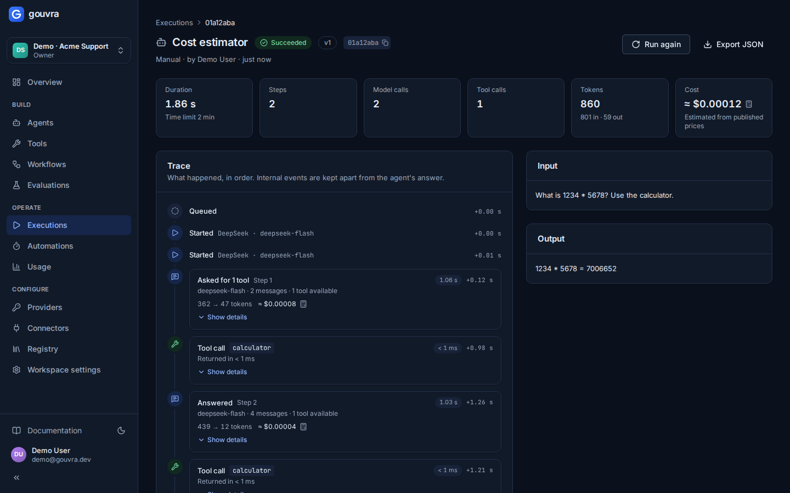
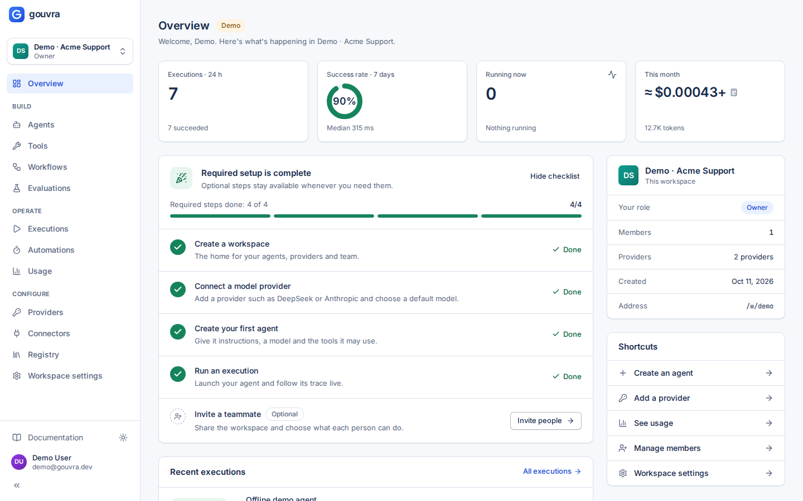
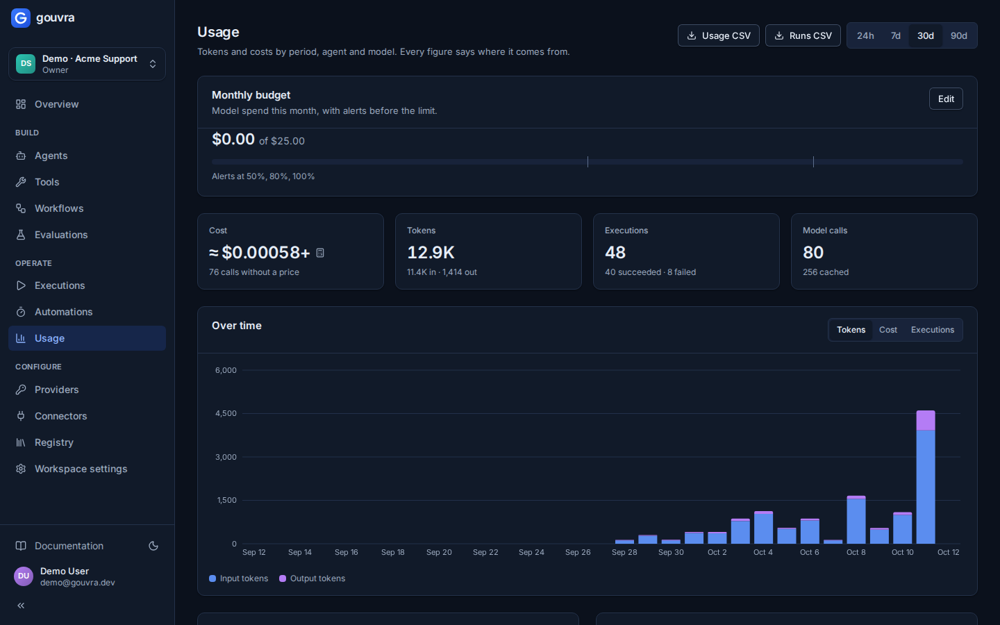

# Gouvra

**The open-source control room for AI agents.** Build agents on the models you choose, give them
only the tools they need, run them in the background and watch every step live — model calls,
tool calls, tokens, costs and errors. When something fails, Gouvra tells you why and what to do.



<p align="center">
  
  
</p>

## Why Gouvra?

Gouvra is the control room you host yourself. When a run fails, it tells you why in plain
language. When it shows a cost, the number comes from the provider or from a published price.

## Features

- **Agents with versions** — instructions, model, parameters, tools and limits; every change is a
  version you can restore; readiness checks before a run.
- **Model providers** — DeepSeek (official API), Anthropic, any OpenAI-compatible API, and an
  offline scripted model for demos and tests. Keys are encrypted at rest and never shown again.
- **Safe tools** — built-ins (calculator, clock, dates, JSON, text, HTTP to allow-listed hosts),
  custom HTTP tools with strict JSON Schemas and server-side credentials, code tools (Python,
  JavaScript) run in a throwaway container without network, a test console and a call history.
- **Live executions** — asynchronous runs with limits (turns, tool calls, tokens, cost, time),
  cancellation, retries, a trace that builds itself as it happens, plain-language failure
  diagnosis and JSON export.
- **Honest costs** — reported by the provider, estimated from published prices, or marked
  unavailable; never an invented number. Usage by period, agent and model.
- **Evaluations** — suites of cases graded by exact match, keywords, regex, JSON Schema or an LLM
  judge; run them on a version or a variant and compare two runs case by case.
- **Teams** — workspaces, roles (owner, admin, member, viewer), invitations, service keys, audit
  log; isolation between workspaces tested on every route.
- **Yours** — self-hosted with one command, Apache-2.0, documented REST API, English and French
  interface, light and dark themes, accessible (WCAG 2.2 AA) and responsive.

## Quick start (under 5 minutes)

Requirements: Docker with Compose v2.

```bash
git clone https://github.com/octavebahoun/gouvra && cd gouvra
scripts/gen-secrets          # generates every internal secret into .env
docker compose up -d         # first build takes a few minutes
```

Open **http://localhost:8080** and sign in with the demo account: `demo@gouvra.dev`, password
`DEMO_PASSWORD` from `.env` (the workspace is labelled *Demo*). Or create your own account — the
confirmation e-mail lands in Mailpit at **http://localhost:8025**.

To use a real model, add a provider in *Providers* (e.g. a DeepSeek key) — or put
`DEEPSEEK_API_KEY` in `.env` before the first start to get two real runs in the demo.

| | |
|---|---|
| Interface | http://localhost:8080 |
| API reference | http://localhost:8080/api/docs |
| E-mails (Mailpit) | http://localhost:8025 |

## Production

[`docker-compose.prod.yml`](docker-compose.prod.yml) adds automatic HTTPS (Caddy), keeps the
database and queue off any public network and runs the worker separately:

```bash
scripts/gen-secrets   # then set DOMAIN, ACME_EMAIL, APP_URL and an e-mail provider in .env
docker compose -f docker-compose.prod.yml up -d --build
```

Configuration, backups and restores, secret rotation and upgrades are described in
[`docs/operations.md`](docs/operations.md).

## Documentation

- [Architecture](docs/architecture.md) — components, request and execution lifecycles, security
  model.
- [Operations](docs/operations.md) — configuration, deployment, backups, rotation, upgrades.
- [API reference](docs/api/openapi.json) — OpenAPI 3.1, also served at `/api/docs`.
- [Security policy](SECURITY.md) · [Contributing](CONTRIBUTING.md) · [Changelog](CHANGELOG.md)

## Development

```bash
# API (Python 3.13, uv)
cd api && uv sync && uv run pytest
# Interface (Node 24, pnpm)
cd web && pnpm install && pnpm dev     # http://localhost:5173, proxies /api to :8000
# Everything the CI runs
scripts/ci-local
```

See [CONTRIBUTING.md](CONTRIBUTING.md) for conventions and the definition of done.

## Licence

[Apache-2.0](LICENSE).
