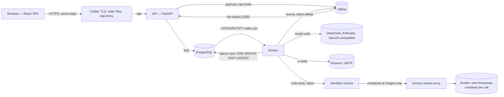

# Architecture

Gouvra is a **modular monolith with a separate worker**: one Python code base with two entry
points (the API and the worker), a React single-page interface, PostgreSQL as the only durable
store and Valkey for ephemeral signals. Decisions and their reasons are logged in
[`DECISIONS.md`](../DECISIONS.md).

## Repository

| Path | Content |
|---|---|
| `api/src/gouvra/core` | Settings, database, errors (RFC 9457), middleware, authentication helpers, central authorisation, rate limiting, crypto, SSRF guard, pagination, logging with redaction. |
| `api/src/gouvra/modules/*` | One package per domain: `identity`, `workspaces`, `notifications`, `audit`, `api_keys`, `providers`, `tools`, `agents`, `executions`, `usage`, `evaluations`, `workflows`, `automations`, `connectors`, `registry`, `billing`, `budgets`, `retention`, `exports`, `admin`. Each has (as needed) `models`, `schemas`, `service`, `routes`, `worker`. |
| `api/src/gouvra/migrations` | Alembic migrations (checked against the models in CI with `alembic check`). |
| `api/src/gouvra/worker` | Worker process: services run side by side — e-mail outbox, executions, evaluation grading, workflow orchestration, automation scheduler, budget and alert evaluation, retention purge. |
| `api/src/gouvra/sandbox` | The code sandbox service (`gouvra sandbox`): its own process and container, no application secret. |
| `api/tests` | Pytest suites against a real PostgreSQL and Valkey (no mocks of our own storage). |
| `web/src` | Interface: `app` (router, providers), `components` (design system), `features/*` (one folder per screen family), `lib` (API client, auth, i18n, formatting), `locales` (EN, FR). |
| `web/e2e` | Playwright journeys, accessibility audits, screenshot specs. |
| `deploy`, `docker-compose*.yml`, `scripts` | Deployment and operations. |

## API

- **FastAPI + Pydantic 2**, SQLAlchemy 2 async on asyncpg. Routes are versioned under `/api/v1`;
  the OpenAPI document (`docs/api/openapi.json`) is exported and the web client types are
  generated from it, so the compiler checks the contract on both sides.
- **Errors** follow RFC 9457 Problem Details with a stable `code`, field errors and the
  `request_id`, which the interface shows as a diagnostic ID.
- **Authentication**: server-side sessions in `__Host-` cookies (HttpOnly, Secure, SameSite=Lax),
  rotated on sign-in and every 12 hours of activity; CSRF tokens bound to the session plus an
  Origin check on every unsafe request. Service keys (`gvr_live_…`, hashed) for scripts and CI.
  Passwords are hashed with Argon2id; OAuth (GitHub, Google) uses PKCE and a signed state.
- **Authorisation** is central: `load_in_workspace()` and `workspace_access()` resolve the actor's
  role in the resource's workspace and check one `Permission`; a resource of another workspace is
  answered with 404, never 403. A test guard fails if a route escapes the isolation suite.
- **Secrets at rest** (provider keys, tool credentials) use AES-256-GCM with a key ring and
  associated data binding each ciphertext to its row; they are write-only through the API.
- **Rate limits** (sliding windows in Valkey) protect sign-in, sign-up, e-mail links, resets,
  invitations and execution launches.

## Executions

1. `POST /agents/{id}/executions` validates the input against the workspace limits and quota,
   records an `Execution` (status `queued`, idempotency key honoured) and `NOTIFY`s the queue.
2. A worker claims it with `FOR UPDATE SKIP LOCKED`, respecting the workspace concurrency limit
   under an advisory lock, and holds a **lease** renewed every 10 s. A reaper fails runs whose
   lease expired (`worker_lost`, retryable).
3. The **engine** loads the agent version (immutable), builds the conversation, and loops: model
   call through the **ModelGateway** (DeepSeek, OpenAI-compatible, Anthropic via its official SDK,
   or the deterministic scripted model), tool calls validated against strict JSON Schemas and
   executed by the tool runtime (built-ins in-process, HTTP tools behind the SSRF guard, code tools
   in the isolated sandbox service), until an answer, a limit (turns, tool calls, tokens, cost, time) or a failure.
4. Every step is an **event** with a database-allocated sequence number, published live on Valkey;
   token deltas are published only. Usage records carry their **cost provenance**:
   `provider_reported`, `estimated` (from the published price table, with DeepSeek peak hours) or
   `unavailable` — never an invented price.
5. The terminal state and its event are committed atomically; cancellation is immediate for queued
   runs and signalled to the worker (NOTIFY + flag) for running ones.

The interface follows a run through `GET /executions/{id}/stream` (Server-Sent Events: replay of
recorded events, then live events and token deltas; `Last-Event-ID` resumes after a disconnect)
and lists update through `GET /workspaces/{id}/stream`.

## Evaluations

A run creates one ordinary execution per case (trigger `evaluation`, lower priority), optionally
with run-only overrides (model, provider, instructions). The worker grades each finished case
(exact, contains, time-boxed regex, JSON Schema, LLM judge metered separately) and keeps the run
summary up to date; two runs compare case by case.

## Workflows

A workflow is a directed acyclic graph of steps — input, agent, tool, condition, transform,
output — edited as a draft (each save names the revision it started from) and published as
immutable versions. A run freezes the graph it executes and advances as a state machine in
PostgreSQL: the worker locks the run, records finished steps, then walks the graph once in
topological order. A step waits until all its inputs are settled and runs when at least one
incoming link is active (a successful source, the matching branch of a condition, or a failure
allowed to continue); otherwise it is skipped, so paths rejoin naturally after a condition.
Agent steps are ordinary executions (same queue, limits and trace) linked to the run; tool steps
run outside the lock. Data moves through checked templates (`{{input.x}}`,
`{{steps.id.output}}`), never through code. Each change publishes the whole run state, which the
interface draws live.

## Automations and connectors

**Schedules** (five-field cron in an IANA time zone) and **signed inbound webhooks** start agents
or published workflows through one launcher, which records every trigger ("fire") with its
outcome. The worker's scheduler locks due schedules (`SKIP LOCKED`), plans the next tick *before*
launching (a failing launch never repeats a tick), skips a tick while the previous run is still
going (configurable), and pauses an automation after five failures in a row. Webhooks verify a
timestamped HMAC signature (or GitHub's), de-duplicate deliveries (explicit delivery id, or the
signed request itself) and refuse paused or oversized deliveries; rejected ones are recorded too.

**Connectors** are a code-defined library (Slack, Discord, GitHub, signed outgoing webhooks). A
connection seals its credentials and publishes each operation as a tool (`kind: connector`) with
a strict schema; the request is built on the server and sent through the guarded HTTP client to
the connector's own hosts only. The **registry** lists every model (with published prices) and
tool, and which agents use them.

## Plans, billing and administration

The **workspace is the organisation**: plans, subscriptions, budgets, retention and exports
attach to it. Plans are defined in code (`billing/plans.py`); with billing off (the default when
self-hosting) every workspace has the unlimited *Self-hosted* plan. One guard (`usage/guard.py`)
is called by every launch path (executions, workflow runs and their steps, evaluation runs,
automations) and applies, in order: suspension, the plan's monthly run quota, a budget's hard
stop; resource creation checks the plan's limits. **Stripe** is the only judge of what is paid:
the plan changes when a signed event arrives (each applied once, the subscription read back
from Stripe), never on the redirect from Checkout. The worker evaluates budgets and quotas every
minute (one alert per month and threshold, e-mailed once) and purges data past each workspace's
retention every hour. `/admin` (super-admins, granted from the command line only) lists the
instance's workspaces and accounts with batched queries, page by page.

## Code sandbox

Code tools never run in the API or the worker. The worker calls the **sandbox** service (its own
process, holding no application secret) with a shared token; the sandbox starts one container
per call through a **Docker socket proxy** that only exposes the containers and images API.
Each container: no network (unless the instance allows it and the tool asks), read-only root,
a small non-executable `/tmp`, user `nobody`, every capability dropped, `no-new-privileges`,
memory without swap, CPU, process and time limits; it is removed after the call, and anything
a crash leaves behind is reaped once expired. The code defines `main(args)`; its result comes
back as JSON, with what it printed.

## Interface

- React 19, React Router (data router, lazy routes: one chunk per screen family), TanStack Query
  as the single cache for server data, Tailwind CSS 4 with semantic design tokens (light and dark
  themes), Radix primitives, Motion for animation, i18next (each language is a chunk loaded
  before the first paint).
- Motion is functional: the execution trace builds itself live, states breathe while running,
  counters roll; `prefers-reduced-motion` keeps every piece of information without movement.
  Long traces are virtualised.
- Accessibility: WCAG 2.2 AA targets, labelled controls with errors tied to fields, focus
  management on navigation, announcements of execution state changes; every screen is audited
  with axe at three widths in both themes.

## Screens

Every screen has a route (lazy-loaded chunk), the permission that opens it, and the same states:
**loading** (skeletons shaped like the content), **empty** (what to do next), **error** (cause,
diagnostic ID, retry), **not found** (also for another workspace's resources) and, where an
action needs more rights, a read-only view or an access notice. Permissions are those of the
API (`core/authz.py`): *viewer* reads, *member* builds and runs, *admin* configures, *owner*
owns the workspace and its subscription.

| Screen | Route | Opens for | Actions need |
|---|---|---|---|
| A. Public site | `/` | everyone | — |
| B. Sign in · C. Sign up | `/login`, `/register` | signed out | — |
| D. E-mail verification | `/verify-email`, `/confirm-email` | link holder | — |
| E. Password reset | `/forgot-password`, `/reset-password` | link holder | — |
| F. Onboarding | `/onboarding` | verified account | — |
| G. Overview | `/w/:slug/overview` | viewer | — |
| H. Agents | `/w/:slug/agents` | viewer | member (create, duplicate, archive) |
| I. Agent editor | `/w/:slug/agents/new`, `/w/:slug/agents/:id/edit` | member | member |
| J. Agent detail | `/w/:slug/agents/:id` | viewer | member (run, restore a version) |
| K. Launch | dialog on agents and agent detail | member | member |
| L. Executions | `/w/:slug/executions` | viewer | member (cancel, retry) |
| M. Execution detail | `/w/:slug/executions/:id` | viewer | member (cancel, retry), export |
| N. Tools | `/w/:slug/tools`, `/w/:slug/tools/:id` | viewer | member (create, test, edit) |
| O. Providers | `/w/:slug/providers` | viewer | admin (add, edit, test, remove) |
| P. Usage | `/w/:slug/usage` | viewer | admin (budget), member (CSV exports) |
| Q. Workspace settings | `/w/:slug/settings/{general,members,api-keys,billing,data,audit}` (and `settings/billing/checkout` in simulated billing) | viewer (sections by permission) | admin (settings, members, keys, audit, retention), owner (plan, ownership, deletion) |
| R. Profile & preferences | `/account` | signed in | — |
| S. Evaluations | `/w/:slug/evaluations`, `…/suites/:id`, `…/runs/:id`, `…/compare` | viewer | member |
| T. Workflows | `/w/:slug/workflows`, `/w/:slug/workflows/:id`, `…/runs/:id` | viewer | member |
| Automations | `/w/:slug/automations`, `/w/:slug/automations/:id` | viewer | admin |
| Connectors | `/w/:slug/connectors` | viewer | admin |
| Registry | `/w/:slug/registry` | viewer | — |
| Invitation | `/invite` | link holder | — |
| Instance administration | `/admin/{workspaces,users,audit}` | super-admin (404 otherwise) | super-admin |

## Quality gates

`scripts/ci-local` replays the CI pipeline: Ruff, mypy (strict), Pytest with coverage on a real
PostgreSQL and Valkey, migration round trip and `alembic check`, OpenAPI contract check, ESLint
(strict type-checked + jsx-a11y), Prettier, TypeScript, Vitest, production build, dependency
audits, Docker images and Playwright end-to-end tests against the running stack.
